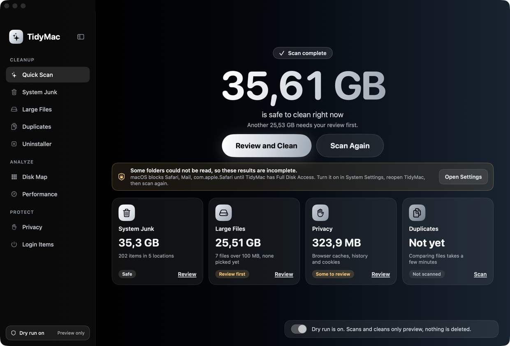
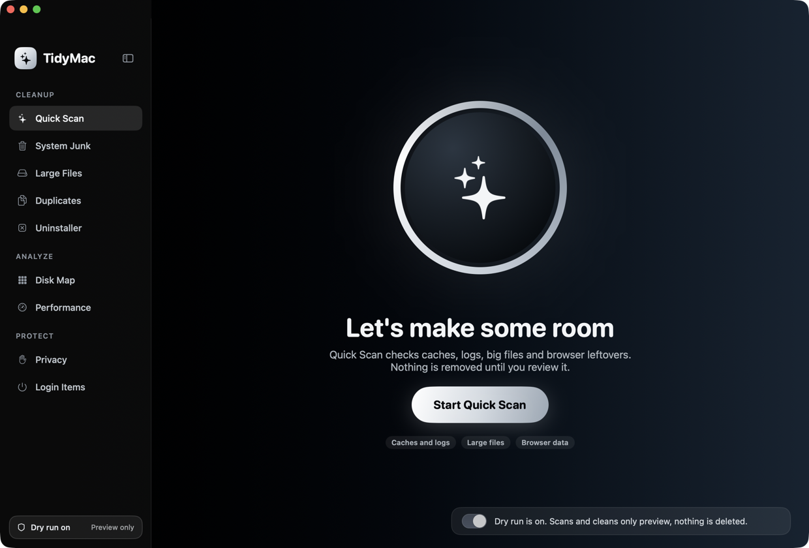
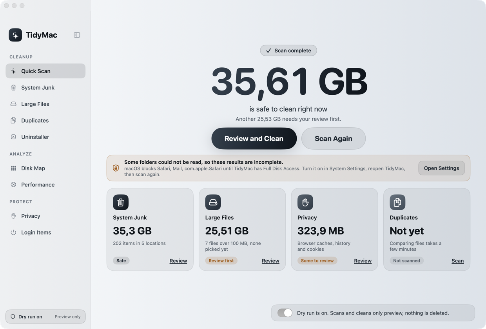
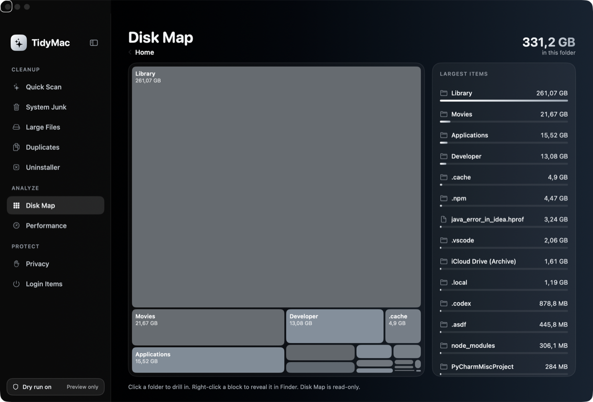
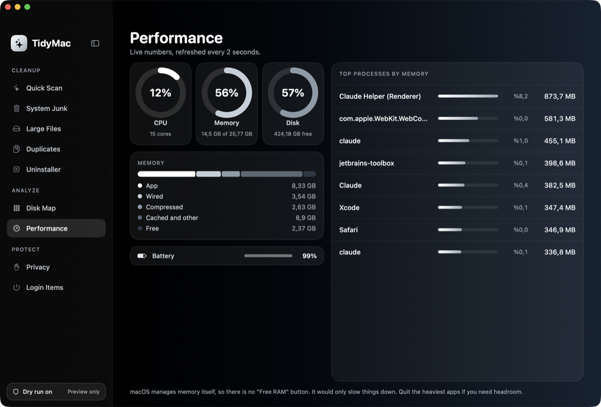
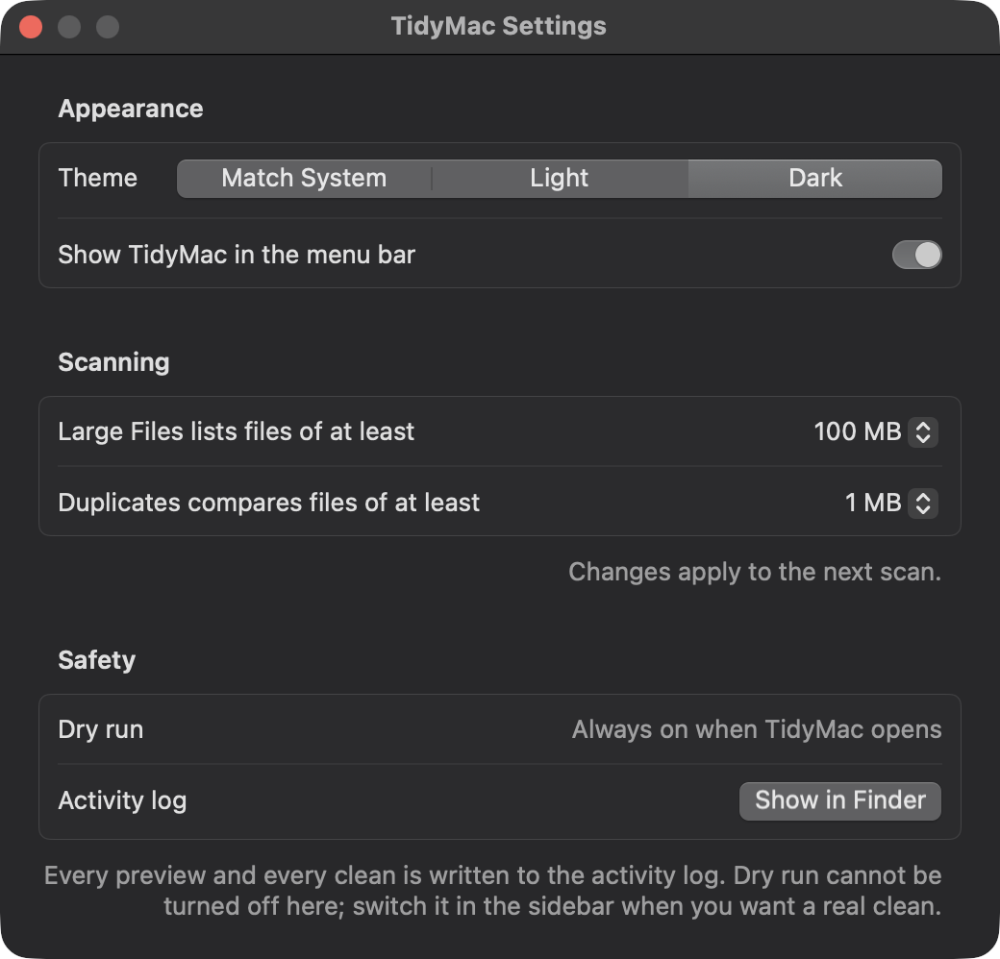

# TidyMac

A Mac cleaner that runs entirely on your machine. Native SwiftUI, no network, no accounts, no telemetry. Version 1.0.0, macOS 14 or later, Apple Silicon and Intel. English and Turkish, light and dark.

TidyMac is an independent personal project. It is not affiliated with, or derived from, any commercial cleaner.

> **Use at your own risk.** TidyMac removes files. It starts in dry run (preview only) every time, sends deletions to the Trash by default and comes with no warranty; see [LICENSE](LICENSE).

## Screenshots



| | |
|---|---|
|  |  |
|  |  |



## Install

1. Download `TidyMac-<version>.zip` from the [Releases](../../releases) page and unzip it.
2. Drag `TidyMac.app` into `/Applications`.
3. Open it. macOS will refuse the first time, because the app is not notarized by Apple (that needs a paid developer account).
4. Go to System Settings → Privacy & Security, scroll to the message about TidyMac and click **Open Anyway**. This is needed once.

Or build it yourself; see [Build and run](#build-and-run).

## Features

| Pane | What it does | Deletes? |
|---|---|---|
| Quick Scan | Runs the System Junk, Large Files and Privacy scans and shows what is safe to clean | via panes |
| System Junk | App caches, logs, Xcode DerivedData/Archives/DeviceSupport, simulator caches, npm and `.cache` | yes |
| Large Files | Files of 100 MB or more (adjustable) in the home folder (not in `Library`, hidden folders or `node_modules`) | yes |
| Disk Map | Clickable treemap of disk usage, drill into folders | no (read-only) |
| Duplicates | Identical files of 1 MB or more (adjustable; size → 64 KB hash → full SHA-256); oldest copy kept | yes |
| Uninstaller | Third-party apps + leftover files matched by bundle ID | yes |
| Login Items | LaunchAgents/Daemons list; user agents can be trashed, which also stops them | yes (user only) |
| Privacy | Safari/Chrome/Firefox caches, history, cookies (never bookmarks) | yes |
| Performance | Live CPU/memory/disk/battery, top processes | no |
| Menu-bar extra | Live CPU % in the menu bar, stats panel, one-click Quick Scan | no |

Deliberately not built: malware scanner, "optimization" tweaks, a Free RAM button (macOS manages memory), auto-update.

## Safety model (short version)

Dry run is on at every launch, and turning it off asks first. Every real clean shows a confirm sheet where Return means Cancel. Deletions go to the Trash unless permanent delete is ticked. Every delete passes `PathPolicy`. Every action is logged. Details: [docs/SAFETY.md](docs/SAFETY.md).

- **Log:** `~/Library/Application Support/TidyMac/log.jsonl`, one JSON object per action.
- **Undo:** open the Trash in Finder, select the items, and choose File → Put Back. Permanent deletes cannot be undone.

## Build and run

Requires macOS 14+ and Xcode.app (the active developer dir may be Command Line Tools only).

```bash
./build_app.sh
```

```bash
open build/TidyMac.app
```

The script quits a running TidyMac, builds a universal release binary into `build/TidyMac.app` and signs it. `./build_app.sh --zip` also writes `build/TidyMac-<version>.zip` for a release. To keep it around, drag `build/TidyMac.app` into `/Applications`.

Tests (XCTest lives in Xcode.app, so point at it for this command):

```bash
DEVELOPER_DIR=/Applications/Xcode.app/Contents/Developer swift test
```

Regenerate the icon: `swift make_icon.swift Resources/AppIcon.icns`.

## Keyboard shortcuts

| Shortcut | Action |
|---|---|
| ⌘1 … ⌘9 | Switch pane (sidebar order) |
| ⌘R | Scan, or scan again, in the current pane |
| ⌘. | Stop the current pane's scan |
| ⇧⌘A / ⇧⌘D | Select all Safe items / deselect all |
| ⌘⌫ | Clean the selected items (preview in dry run, confirm sheet otherwise) |
| ⌃⌘S | Collapse the sidebar to an icon rail, or expand it |
| ⌘, | Settings |

## Settings

Theme (match system, light, dark), whether the menu-bar item is shown, and the size thresholds for Large Files and Duplicates. Dry run is not a setting: it is on every time TidyMac opens.

## Languages

English and Turkish. macOS picks the language from System Settings → General → Language & Region; to use Turkish for TidyMac only, add it there under Applications. All text lives in `Resources/Localizable.xcstrings`. After changing any user-facing text:

```bash
./localize.sh
```

That refreshes the catalog from the source code. Fill in the new Turkish entries (Xcode opens the file as a table), and `swift test` fails until none are missing.

## Permissions

Not sandboxed. macOS hides Safari data and some `~/Library` folders from apps without Full Disk Access; when that happens TidyMac shows a banner saying the results are incomplete.

1. Open System Settings → Privacy & Security → Full Disk Access (the banner's "Open Settings" button goes there).
2. Add `TidyMac.app` and switch it on.
3. Quit and reopen TidyMac, then scan again.

With the default ad-hoc signature macOS treats every rebuild as a new app and forgets the grant. To make it stick, create a self-signed code-signing certificate once (Keychain Access → Certificate Assistant → Create a Certificate…, type "Code Signing") and build with it:

```bash
TIDYMAC_SIGN_ID="Your Certificate Name" ./build_app.sh
```

## Docs

- [docs/ARCHITECTURE.md](docs/ARCHITECTURE.md): targets, modules, data flow
- [docs/SAFETY.md](docs/SAFETY.md): deletion rules, allowlist, what is blocked
- [docs/DESIGN.md](docs/DESIGN.md): the UI as built
- [docs/DECISIONS.md](docs/DECISIONS.md): why things are the way they are, known issues
- [CHANGELOG.md](CHANGELOG.md)

## Licence

All rights reserved; see [LICENSE](LICENSE). You are welcome to read the code and run the app; the source is not offered for reuse or redistribution.
